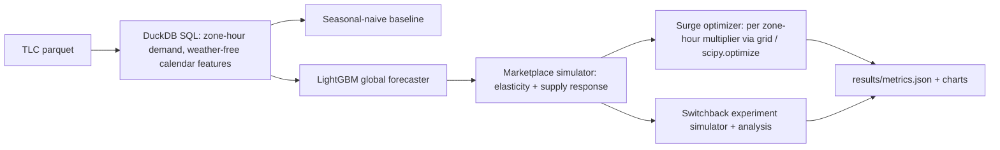

# Ride-Hail Demand Forecasting, Surge-Pricing Optimization, and Switchback Experiment Simulation

`ride-pricing-marketplace` · new project · estimated build effort: 5 h

## Problem

Marketplace pricing teams forecast demand by zone and hour, set prices that balance riders and drivers, and test pricing changes with switchback experiments because a normal A/B test is contaminated by shared driver supply. This project forecasts zone-hour demand from NYC taxi trip records and builds a marketplace simulator (rider price elasticity, driver supply response). It optimizes a surge multiplier per zone-hour and runs simulated switchback experiments to check that the analysis recovers the true effect.

## Target jobs and skills

- **Lyft — Data Scientist, Algorithms** (`438ae477dcc3`): covers 94% of the JD's weighted top skills (Python, SQL, Statistics, Causal Inference, Optimization, Machine Learning, A/B Testing, Simulation, Time Series)

Skills/tools this project demonstrates: Python, SQL, Time Series, Gradient Boosting, LightGBM, Optimization, Simulation, Causal Inference, A/B Testing, Statistics, Machine Learning, Feature Engineering, Data Visualization

## Data

- **Dataset:** NYC TLC Yellow Taxi Trip Records (Jan-Apr 2024) — https://www.nyc.gov/site/tlc/about/tlc-trip-record-data.page
- **License/terms:** NYC Open Data (public, no restrictions)
- **Size used:** 4 monthly parquet files, ~200 MB, aggregated to ~260 zones x 2,900 hours
- **Plan:** Forecast trained on Jan-Mar, tested on April. Simulator parameters (elasticity, supply response) are set from published ranges and stated as assumptions.

## Architecture

## Tech stack

Python 3.11, DuckDB, LightGBM, SciPy, statsmodels, pandas, matplotlib, pytest

## Deliverables

- SQL aggregation pipeline and forecast models with backtests
- Marketplace simulator with documented assumptions and unit-tested invariants
- Surge optimizer and a comparison with flat pricing
- Switchback design (randomized time blocks) with a cluster-robust analysis and a CI-coverage check

## Success criteria (all must hold on a from-scratch `python run.py`)

| Metric | Threshold | How it is measured |
|---|---|---|
| April zone-hour demand WAPE (top 50 zones) | <= 25% and >= 15% better than seasonal-naive | held-out April |
| Completed trips under optimized surge vs. flat pricing | >= 5% more in simulation at equal or lower average rider price | simulator |
| Switchback analysis 95% CI coverage of the true effect | >= 92% over 500 simulated experiments | simulator |
| Naive user-level A/B bias under interference | reported; switchback bias must be < 1/3 of naive bias | simulator |
| Test coverage of src/ | >= 70% | pytest --cov |

## Baseline

Seasonal-naive forecast (same hour, previous week) and flat pricing (multiplier 1.0).

## Constraints

- Runs on Windows with `python run.py` from a fresh virtualenv; no make, shell scripts, paid APIs, or accounts.
- CPU-only by default (an optional `--device cuda` flag is fine); peak RAM <= 3 GB; total downloads <= 1.5 GB.
- PyTorch (if used) pinned to the CPU wheel via `--extra-index-url https://download.pytorch.org/whl/cpu`.
- Fixed random seeds; every reported number is written by code to results/metrics.json (never typed by hand).
- Test split is created once, saved, and never used for training, tuning, or threshold selection.
- Data download is scripted (Python requests), cached under data/, and verified by checksum or row count.
- Forecast features use only data available before the forecast hour.

## Draft resume bullets (placeholders are filled only with reproduced metrics)

- Forecast NYC zone-hour taxi demand with LightGBM at [WAPE] WAPE on a held-out month, [IMPROVE] better than a seasonal-naive baseline
- Built a marketplace simulator and surge-pricing optimizer that raised simulated completed trips by [TRIPS_LIFT] over flat pricing
- Designed switchback experiments that cut interference bias to [SB_BIAS] of a naive A/B test, with [COVERAGE] CI coverage over 500 simulations
