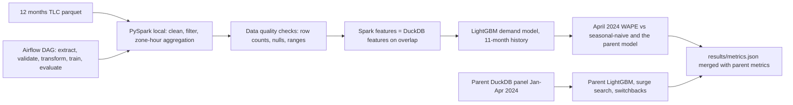

# NYC taxi demand at a larger history: PySpark ETL, feature parity, and an Airflow DAG

Yellow-taxi pickups from January through March 2024 forecast April demand by zone and hour, and those forecasts feed a marketplace simulator for surge search and switchback experiments. This extension keeps that pipeline and adds the data-engineering layer around it. PySpark in local mode cleans a full year of TLC trip records (May 2023 through April 2024) and aggregates them to zone-hour counts. Those counts are checked against the existing DuckDB aggregation on the four months both engines read. A LightGBM demand model is then retrained on the 11 months before April 2024 and scored on that same held-out month. Extract, validate, transform, train, and evaluate are written as an Airflow DAG. Airflow is not started here: the DAG file is checked by parsing it, and a local runner calls the same task functions in dependency order.

## Setup

```text
python -m venv .venv
.venv\Scripts\pip install -r requirements.txt
```

Python 3.11 or 3.12. Java 17 is required for the local Spark session. No paid APIs and no GPU.

## How to run

From this folder:

```text
python run.py
```

That downloads twelve TLC parquet files into `data/` (cached on later runs), re-runs the parent forecast, simulator, and switchback study, runs the five DAG tasks, writes `results/`, and refreshes the results table below plus `RESUME_NOTES.md`.

```text
python run.py --quick
```

`--quick` skips the download and runs the same code on a small synthetic trip file. It is the path the tests use, and it finishes in a few minutes. Optional flags: `--output-dir`, `--cache-dir`, and `--device cpu` (the default). `--device cuda` is accepted and ignored; training stays on CPU.

The Spark ETL can also be launched with spark-submit. It downloads or reuses the cached files, then validates and aggregates. It does not train the model:

```text
.venv\Scripts\spark-submit --master local[2] --driver-memory 1g spark\job.py --cache-dir data --output-dir results
```

Tests:

```text
python -m pytest --cov=src --cov=spark --cov-report=term-missing
```

The coverage criterion is at least 75% of `src/` and `spark/` together. `python run.py` records the measured fraction in `results/metrics.json`.

## Architecture



## Design decisions

The parent forecast, split dates, simulator, and switchback study are unchanged. `python run.py` re-runs them first so the headline metrics can be compared with the verified parent run.

Spark and DuckDB keep a trip when the pickup falls in the requested window and the zone id is between 1 and 263. Fare and distance are quality checks, not extra filters. Dropping zero fares or zero distances would make the overlap disagree with the verified DuckDB panel, and the April WAPE would no longer be on the same trips. A month fails validation if a null rate exceeds 1%, if more than 8% of fares are null or outside (0, 500], if more than 20% of distances are null or outside [0, 100], or if the raw row count does not match the pinned checksum. The 20% distance gate is loose on purpose: yellow-taxi files contain a real share of zero-distance rows, and the gate is still low enough to fail a broken extract.

Files from May through December 2023 are aggregated on [2023-05-01, 2024-01-01). The four 2024 files are aggregated on [2024-01-01, 2024-05-01), which is the parent window. A stray 2024 timestamp inside a 2023 file therefore cannot change the overlap counts. The parity check compares the January-April slice of the Spark panel, limited to zones that have at least one trip in that window, with a fresh DuckDB aggregation of those four files.

Calendar fields use DuckDB's Sunday=0 day-of-week. Spark reads the parquet timestamps as timezone-naive values in a UTC session so `date_trunc('hour', ...)` stays on the wall-clock hour stored in the file.

The 11-month model uses the same lags, loss, and hyperparameters as the parent. Supervised rows before 18 March 2024 are training rows. Early stopping watches 18-31 March only. April is never used to train, stop trees, or rank zones. The top zones are still the busiest zones in the parent's training window (29 January through 17 March 2024), so the held-out comparison is the same zone set when the overlap counts match. The longer history is the change.

The DAG id is `nyc_taxi_demand`, the schedule is `0 6 * * *`, and the tasks are extract, validate, transform, train, evaluate, in that order. The validator reads the file as syntax and checks the task ids, the `>>` edges, and the schedule. The local runner imports the task functions and calls them. Nothing in this project submits a job to a cluster or starts a scheduler.

MLflow logs the training parameters and the March validation WAPE for the top zones. The April WAPE is logged only after the booster is already chosen.

## Results

<!-- RESULTS_START -->

| Criterion | Value | Threshold | Passed |
|---|---:|---:|:---:|
| April zone-hour demand WAPE (top 50 zones) | 0.146127 | <= 0.250000 | yes |
| April zone-hour demand WAPE (top 50 zones) improvement vs seasonal-naive | 0.242733 | >= 0.150000 | yes |
| Completed trips under optimized surge vs. flat pricing | 0.213094 | >= 0.050000 | yes |
| Average rider price under optimized surge vs flat pricing | 18.755521 | <= 20.000000 | yes |
| Switchback analysis 95% CI coverage of the true effect | 0.942000 | >= 0.920000 | yes |
| Switchback bias vs one third of naive user-level A/B bias | 0.011451 | < 1.598972 | yes |

| Metric | Value |
|---|---:|
| April top-zone WAPE, LightGBM | 0.146127 |
| April top-zone WAPE, seasonal naive | 0.192966 |
| March validation WAPE, LightGBM | 0.147447 |
| March validation WAPE, seasonal naive | 0.185280 |
| WAPE improvement vs naive | 0.242733 |
| Simulated trips, optimized | 3510636.0811 |
| Simulated trips, flat | 2893951.8293 |
| Trip lift | 0.213094 |
| Avg rider price, optimized | 18.755521 |
| Avg rider price, flat | 20.000000 |
| Switchback 95% CI coverage | 0.942000 |
| Switchback absolute bias | 0.011451 |
| Naive user-level absolute bias | 4.796915 |
| Bias ratio (switchback / naive) | 0.002387 |
| Runtime seconds | 5.92 |
| Peak RSS GiB | 0.4303 |

Values are fractions (0.25 means 25%), except prices in USD, trip totals, seconds, and GiB.
This table is written by `python run.py` from `results/metrics.json`.

<!-- RESULTS_END -->

Plots written next to the metrics file:

- `results/wape_comparison.png`
- `results/forecast_example_zone.png`
- `results/surge_multiplier_hist.png`
- `results/switchback_estimates.png`
- `results/demand_wape_11m.png`

## Evaluation artifacts

Parent metrics are computed from the parent CSVs, as before. The extension adds files an outside check can read without trusting the README. `row_id` on the April file is `zone|hour_ts`.

| File | Role |
|---|---|
| `results/forecast_test_predictions.csv` | Parent April top-zone actuals, LightGBM, and seasonal naive |
| `results/top50_zones.csv` | Parent training-period zone ranking |
| `results/surge_zone_hour.csv` | Multiplier, completed trips, and rider price versus flat |
| `results/switchback_experiments.csv` | One row per experiment: estimate, 95% CI, true effect |
| `results/naive_ab_cells.csv` | User-level contrast and citywide effect by zone-hour |
| `results/spark_parity.json` | Overlap months, row counts, matched rows, max absolute feature gap |
| `results/spark_stage_counts.json` | Raw, cleaned, and aggregated row counts, total trips, ETL seconds |
| `results/demand_test_predictions_11m.csv` | April 2024 top zones: actual, 11-month prediction, seasonal naive |
| `results/dag_run.log` | Local runner start and success lines for the five tasks |
| `results/airflow_check.json` | DAG id, task count, order, acyclic flag, and whether every task succeeded |

- WAPE = sum(abs(actual - prediction)) / sum(abs(actual))
- Spark parity passes when every overlap zone-hour is in both frames and the maximum absolute gap in trips, hour, day of week, month, and weekend flag is at most 1e-9
- The 11-month April WAPE has to be at or below the parent model's April WAPE from the same run, and below the seasonal-naive WAPE on the same rows

## Dataset

NYC TLC Yellow Taxi Trip Records, May 2023 through April 2024, from the [TLC trip record data page](https://www.nyc.gov/site/tlc/about/tlc-trip-record-data.page). The parent study uses January through April 2024. The extension adds May through December 2023 from the same public bucket.

License: NYC Open Data. These yellow-taxi trip records are public city data published by the NYC Taxi and Limousine Commission. The trip-record page does not name a separate software license, a fee, or a restriction on reuse. `python run.py` downloads the parquet files from the TLC CloudFront bucket, caches them under `data/`, and checks a SHA-256 and a row count. The 2024 pins live in `src/ride_pricing/config.py`. The 2023 pins live in `src/ride_pricing/year_config.py`.

## Limitations

Spark runs as `local[2]` with a 1 GB driver heap inside this process. This is not a cluster, Databricks, EMR, or any other shared Spark service. The Airflow file is a DAG definition plus a static check. No scheduler is installed or running, and the local runner is not an Airflow deployment. Do not describe this project as production orchestration.

Yellow taxis are a public stand-in for ride-hail, not Uber or Lyft trips. Elasticities and the peak and off-peak supply ratios are assumptions, so the parent trip lift is a property of the simulator, not a measured launch result. The 11-month model does not use weather, events, or neighboring zones. Fare and distance problems are counted and gated, then left in the trip totals so the overlap can match DuckDB. Peak memory of the whole command, including the Spark JVM, is meant to stay under 3 GB. DuckDB is capped at 1.5 GB during the parent aggregation, and LightGBM uses 4 threads. The JVM is stopped before the 11-month fit.

Parent test coverage of `src/` was already measured above 70%. The extension criterion is at least 75% of `src/` and `spark/` together, measured with `pytest-cov` during `python run.py`.
