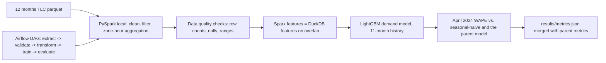

# NYC Taxi Demand Pipeline at Scale - PySpark ETL and Features, Airflow Orchestration, on Top of the Pricing Project

`ride-pricing-spark` · extend project · estimated build effort: 4 h

## Problem

Extends the verified NYC taxi demand and pricing project (ride-pricing-marketplace) with the data-engineering layer that production ML teams expect: the raw TLC trip records for a full year are cleaned and aggregated to zone-hour features with PySpark (local mode), the Spark features are checked to match the existing DuckDB features exactly on the overlapping months, the demand model is retrained on the larger history and evaluated on the same held-out month, and the whole pipeline is defined as an Airflow DAG (extract, validate, transform, train, evaluate). Airflow does not run natively on Windows, so the DAG is validated statically (tasks, dependencies, schedule) and the same task callables are run end to end by a small local runner in dependency order. All previous tests and metrics must still pass.

## Target jobs and skills

- **DoorDash — Software Engineer, Machine Learning Platform - MDX** (`ef00bf6039ff`): covers 40% of the JD's weighted top skills (Python, Machine Learning, Airflow, Spark)
- **AbbVie — Machine Learning Engineer** (`7d773407fbb7`): covers 45% of the JD's weighted top skills (Python, SQL, Machine Learning, Spark, Airflow)
- **Princeton University — Data/ML Engineer** (`69639ff6e992`): covers 53% of the JD's weighted top skills (Python, SQL, Machine Learning, Spark)
- **Ibotta — Data Scientist, Strategic Partner Analytics** (`b7ea7cc90f1f`): covers 88% of the JD's weighted top skills (Python, SQL, Machine Learning, Causal Inference, Statistics, Gradient Boosting, Spark, Airflow, A/B Testing)
- **Intuit — Senior Machine Learning Engineer** (`0641ef9cb26c`): covers 50% of the JD's weighted top skills (Python, SQL, Machine Learning, Spark)
- **Competera — Data Scientist** (`4d52e3bfe8f0`): covers 83% of the JD's weighted top skills (Python, SQL, Machine Learning, Time Series, Gradient Boosting, A/B Testing, Statistics, LightGBM, Spark, Optimization)

Skills/tools this project demonstrates: Python, SQL, Time Series, Gradient Boosting, LightGBM, Optimization, Simulation, Causal Inference, A/B Testing, Statistics, Machine Learning, Feature Engineering, Data Visualization, Spark, Airflow

## Data

- **Dataset:** NYC TLC Yellow Taxi Trip Records (12 months, 2023-05 through 2024-04) — https://www.nyc.gov/site/tlc/about/tlc-trip-record-data.page
- **License/terms:** NYC Open Data (public, no restrictions)
- **Size used:** 12 monthly parquet files, ~600 MB, ~38M trips (downloaded by script)
- **Plan:** Same held-out month as the parent (April 2024) for the demand model; training uses the 11 earlier months. Parent data, splits, simulator, and experiments are unchanged.

## Architecture

## Tech stack

Python 3.11, PySpark (local mode), Apache Airflow DAG definition (static validation; no Airflow runtime on Windows), DuckDB, LightGBM, MLflow, pytest

## Deliverables

- {'spark/ package': 'ingestion, cleaning, zone-hour aggregation and feature jobs runnable with spark-submit in local mode'}
- Data-quality checks with explicit thresholds (row counts per month, null rates, fare and distance ranges) and tests
- Parity check that Spark and DuckDB features are identical on the months both compute
- Airflow DAG file with five tasks, a static validator (AST/parse check of tasks, dependencies, schedule) and a local runner that executes the same task callables in dependency order, with a recorded run log
- Retrained demand model on 11 months, evaluated on the parent's held-out April 2024; MLflow run tracking; README section

## Success criteria (all must hold on a from-scratch `python run.py`)

| Metric | Threshold | How it is measured |
|---|---|---|
| Spark vs. DuckDB feature parity on overlapping months | 100% of zone-hour rows match (counts exact; numeric features within 1e-9) | parity test |
| Demand WAPE on held-out April 2024 with the 11-month model | <= the parent's 14.6% and below the 19.3% seasonal-naive baseline | same test month as the parent |
| Pipeline throughput | full 12-month Spark ETL completes in <= 30 minutes on the laptop, with row counts reported per stage | timed run |
| Airflow DAG | DAG file validates statically (5 tasks, acyclic, expected order) and the local runner completes all 5 tasks | pytest + recorded log |
| Parent project | all previous tests pass and headline metrics reproduce within 2% | re-run |
| Test coverage of src/ and spark/ | >= 75% | pytest --cov |

## Evaluation artifacts (required; the evaluator recomputes metrics from these)

- results/spark_parity.json with keys months_compared, rows_spark, rows_duckdb, rows_matched, max_abs_diff
- results/spark_stage_counts.json with row counts per stage (raw, cleaned, aggregated) and total_trips, runtime_s
- results/demand_test_predictions_11m.csv with columns zone, hour_ts, actual, pred, pred_seasonal_naive (April 2024 only)
- results/dag_run.log from the local runner plus results/airflow_check.json with keys dag_id, n_tasks, task_order, acyclic, all_succeeded

## Baseline

The parent project's DuckDB feature pipeline and its 3-month demand model (14.6% WAPE); seasonal-naive (19.3%).

## Constraints

- Runs on Windows with `python run.py` from a fresh virtualenv; no make, shell scripts, paid APIs, or accounts.
- CPU-only by default (an optional `--device cuda` flag is fine); peak RAM <= 3 GB; total downloads <= 1.5 GB.
- PyTorch (if used) pinned to the CPU wheel via `--extra-index-url https://download.pytorch.org/whl/cpu`.
- Fixed random seeds; every reported number is written by code to results/metrics.json (never typed by hand).
- Test split is created once, saved, and never used for training, tuning, or threshold selection.
- Data download is scripted (Python requests), cached under data/, and verified by checksum or row count.
- Spark runs in local mode; Airflow is a validated DAG definition only (not executed in an Airflow scheduler). Never claim a cluster, Databricks, EMR, a running Airflow deployment, or production use.
- Public data only.

## Draft resume bullets (placeholders are filled only with reproduced metrics)

- Built a PySpark ETL over [TRIPS] NYC taxi trips (12 months) with data-quality checks, matching DuckDB features on 100% of overlapping zone-hours
- Defined the extract, validate, transform, train, and evaluate steps as an Airflow DAG (statically validated) and ran the same tasks end to end with a local runner
- Retrained the demand model on 11 months of history at [WAPE]% WAPE on held-out April 2024 vs. 19.3% for seasonal-naive
